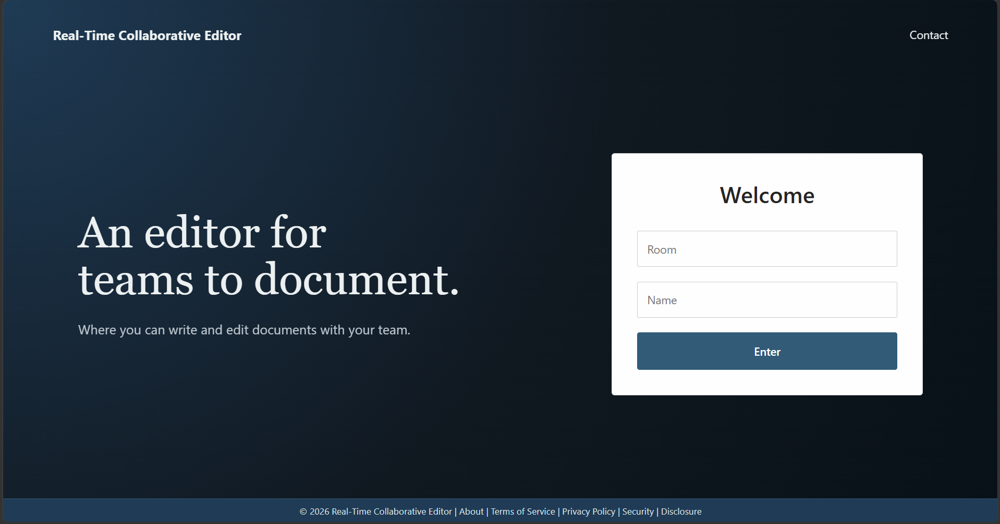
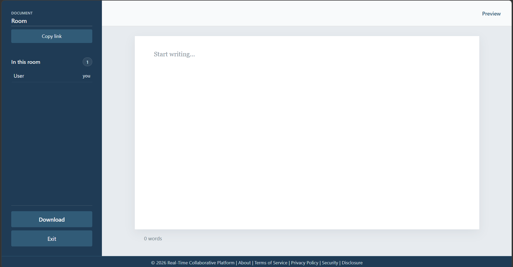

# Real-Time Collaborative Editor

A real-time collaborative editor designed for multi-user collaboration and seamless team workflows.

## Features
- Live Markdown editing with concurrent changes merged automatically
- Room-based collaboration with participant presence, typing indicators, live cursors, and selection highlights
- Shared document titles and content, automatically saved for each room
- GitHub-flavored Markdown preview, word count, and PDF export through the browser's print dialog
- Copyable room links for inviting collaborators

## Tech Stack
- JavaScript
- HTML
- CSS
- React
- Vite
- Node.js
- Express.js
- SQLite
- Socket.IO
- Yjs
- React Markdown

## How It Works
The document title and Markdown canvas are bound to a shared Yjs document. Yjs merges concurrent edits, while Socket.IO synchronizes document updates and room presence. The sidebar shows the editable document title, participants, and sharing controls without a separate “DOCUMENT” heading. The backend saves each room's title and content in SQLite. Cursor positions, selections, and typing status are temporary and are removed when collaborators leave. The Markdown preview supports GitHub-flavored syntax, and PDF export uses the browser's print dialog. Copying a room link includes the room name for invitees. Rooms do not require sign-in, so anyone who knows a room name can join; do not use private or sensitive content, and only deploy this application where you trust the users who can access it.

## Getting Started
### Prerequisites
- Node.js 18+

### Installation

1. Clone the repository and install backend dependencies from the project root:
```bash
git clone https://github.com/mohamedaradaib/Collaborative-Editor
cd Collaborative-Editor
npm install
```

2. Install frontend dependencies:
```bash
npm --prefix frontend install
```

### Run the Application

Open two terminals from the project root.

#### Terminal 1: Start the backend
```bash
npm start
```

#### Terminal 2: Start the frontend
```bash
npm --prefix frontend run dev -- --host 0.0.0.0
```

Open the Vite localhost url `http://localhost:5173`

## Live Demo
[https://real-time-collaborative-editor-production.up.railway.app/](https://real-time-collaborative-editor-production.up.railway.app/)

## Screenshots




## License
Distributed under the MIT License. See [LICENSE](./LICENSE) for more information.
